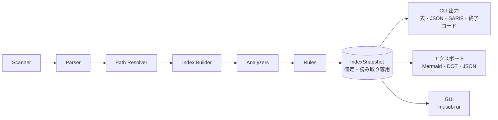

# musubi 設計書

[requirements.md](./requirements.md) の要件をどう実現するかをまとめる。要件は `F-xx` / `NFR-xx` / 検証ルール ID で参照する。

---

## 1. 全体構成



解析はすべてコアで 1 回だけ行い、その結果（`IndexSnapshot`）を CLI・エクスポート・GUI が共有する。`IndexSnapshot` は「確定した解析結果」として扱い、生成後は読み取り専用にする。CLI・エクスポート・GUI は依存関係を再計算しないので、CLI と GUI で結果が食い違うことがない。

診断（`Diagnostic`）を作るのは Rules だけにする。Scanner や Parser で起きたエラー（読み取り失敗、YAML 不正など）はその場で診断にせず事実として記録し、Rules が E001・E008 などに変換する。診断の出どころが 1 か所になり、重大度の上書きや無効化もそこで一括して効かせられる（NFR-07）。

| レイヤー | 責務 |
| --- | --- |
| Scanner | 探索ルート配下を走査し、`SKILL.md` を持つディレクトリを列挙する（2 章） |
| Parser | frontmatter（YAML）と本文（Markdown AST）を解析し、リンクと他 SKILL への言及を抽出するだけ。パスの解決や存在確認はしない |
| Path Resolver | 抽出したリンクを分類・正規化し、存在確認と「どの SKILL の中を指すか」の判定を行う（3 章） |
| Index / Graph | SKILL・ファイル・エッジの索引（Index Builder が構築）と、汎用のグラフ処理（隣接リスト、`FindCycles`・`Reachable`・`ReverseEdges`）。エッジの意味は解釈しない |
| Analyzers | Graph を使った意味的な解析。DependencyAnalyzer（`requires` の欠落・循環）、ReferenceAnalyzer（パス解決の結果）、InferenceAnalyzer（言及の推論）。診断は作らない |
| Rules | Analyzer の結果を診断に変換する。1 ルール 1 ファイルで、重大度の上書き・無効化もここで適用する |
| Presenters | CLI 表示、Mermaid / DOT / JSON / SARIF 出力、GUI 向け JSON API |

**設計原則**

- コマンドは薄く、ロジックはコアとルールに集める（テストしやすく、GUI からも再利用できる）
- 解析は純粋関数に寄せる：ファイルシステムの読み取り → スナップショット → 診断、の一方向
- 書き込み系コマンドは「変更計画を作る → 表示 → 適用」の 2 段構えにし、`--dry-run` を自然に実現する（6 章）
- キャッシュは入れず、毎回全体を解析する。差分解析が要るかは watch（F-16）を入れてから判断する（NFR-01）

## 2. 探索（F-01）

Scanner は後続すべての処理の入口なので、判断が要る点を先に決めておく。

| 項目 | 方針 |
| --- | --- |
| 探索ルート | `.claude/skills/` の 1 つに固定。`--root` でテスト用に 1 つだけ上書きできる |
| 検出単位 | 探索ルート直下のディレクトリで `SKILL.md` を持つもの（`<root>/<name>/SKILL.md`）。Claude Code の標準配置に合わせる |
| 検出後の走査 | SKILL を見つけたディレクトリの中は付属ファイルとして扱い、その中でさらに SKILL を探さない |
| ルート直下の `SKILL.md` | SKILL として扱わず W006 |
| ネストした SKILL（`internal/security/SKILL.md` など） | SKILL として扱わず W006。`name` は親ディレクトリ名と一致させる必要があるため、分類用フォルダを許すと名前が衝突しやすい |
| シンボリックリンク | ルート直下のディレクトリへのリンクに限り、実体を解決して SKILL として扱う（共有 SKILL をリンクで置く運用に対応するため）。リンク先がリポジトリ外なら W007（設定 `[symlinks].allowed_targets` に書いたものは除く）。SKILL 内部のディレクトリへのリンクはたどらない（無限ループとルート外への脱出を防ぐ） |
| 二重検出 | 実体パスで重複を除き、リンク側を除外する（`--verbose` で表示） |
| `.gitignore` | ネストした `.gitignore` と `.git/info/exclude` を含めて従い、除外対象には入らない。go-git の gitignore パッケージで判定し、git コマンドには依存しない。`--no-ignore` で無効化 |
| 読み取りエラー | 握りつぶさず E008 として診断に出す。探索は続行し、終了コードは 1 |

## 3. リンク解析とパス解決（F-04）

Parser はリンクを抽出するだけにし、パスの解決や SKILL 間の関係の判定は後段に分ける。それぞれ単体でテストできるよう、処理は次の順で一方向に流す。

```
Markdown Parser → Link Extraction → Path Resolver → File Validation → Dependency Inference
```

**抽出の対象**

- 対象：インラインリンク、参照形式リンク（`[text][ref]`）、画像。goldmark の AST では参照形式も解決済みのリンクノードとして得られる
- 対象外：コードブロックとインラインコードの中、HTML コメントの中、生 HTML の `href`（v1 では扱わない）
- 言及（`mention`）の検出はリンク抽出とは別の処理で、インラインコード内の SKILL 名も対象にする（4.4）

**リンクの分類と扱い**

| 分類 | 例 | 扱い |
| --- | --- | --- |
| 外部 URL | `https://example.com` | 検証しない（ネットワークに出ない。NFR-03） |
| ページ内アンカー | `#usage` | 検証しない |
| SKILL 内の相対パス | `references/checklist.md` | 存在確認（E007）、参照の連鎖の確認（W002） |
| 他 SKILL のファイル | `../api-review/references/x.md` | 存在確認と W004。`file-ref` エッジを作る |
| リポジトリ外・絶対パス | `/etc/hosts`、`../../../x` | 存在確認はせず W004 |

**Path Resolver が行う正規化**

1. `#` 以降と `?` 以降を取り除く（アンカー先の見出しの存在確認は v1 ではしない）
2. URL エンコードを戻す（`%20` → 空白）
3. `SKILL.md` のあるディレクトリを基準に結合し、`..` を正規化する
4. 正規化したパスが、自分の SKILL／他の SKILL／どの SKILL でもない、のどれに入るかを判定する
5. 大文字小文字だけが違うパスは macOS・Windows では見つかってしまうため、実ファイル名と完全一致しなければ E007 とする（Linux の CI と結果を揃える）

## 4. 依存解析（F-06・F-07・F-12）

### 4.1 SKILL の識別子と名前の解決

内部では実体パスから作る `ID` で SKILL を識別し、`name` は表示と依存宣言にだけ使う。依存宣言は名前で書かれているので、Index を作るときに ID へ解決する。

- 名前に当てはまる SKILL が 1 つ → `resolved`
- 該当なし → `missing`（E003 / W005）
- 同じ名前の SKILL が複数 → `ambiguous`。E005 を出し、そのエッジは循環検出と到達性計算から外す（どちらを指すか決められないため）。GUI では候補すべてへ点線で結ぶ

探索ルートが 1 つなので、名前の重複は通常は起きない。それでも ID を持つのは、制約違反があってもグラフを壊さずに表示するためと、将来ルートが増えたとき（F-15・F-17）に備えるため。

### 4.2 `related` の扱い

`related` は対称な関係として扱う。内部では有向エッジで持つが、逆引きでは両方向に辿れるようにする。両側に同じ宣言が書かれていれば 1 本に統合する。

### 4.3 循環検出（E004）

- 対象は `requires` のみ。`related` は循環を許容し、推論エッジ（`file-ref`・`mention`）と `ambiguous` なエッジは判定に含めない
- 自己依存（A が A を requires）も循環として扱う
- 強連結成分ごとに 1 件の診断にする。A → B → C → A なら E004 は 1 件で、含まれる SKILL とエッジをすべて持つ
- 診断の主な位置はグループ内で ID が最も小さい SKILL の宣言行にし、他のメンバーの宣言行は関連位置（`Diagnostic.Related`）として持たせる（出力を決定的にするため。NFR-05）

### 4.4 言及の推論（F-12）

本文に名前が出ただけでは依存とは限らない（「このリポジトリでは api-review を使わない」など）。そこで検出方法ごとに信頼度を付け、v0.2 では高・中だけを対象にする。推論エッジは信頼度（`Edge.Confidence`）を持ち、I001 のメッセージと GUI の表示に反映する。

| 段階 | 検出方法 | 信頼度 | v0.2 |
| --- | --- | --- | --- |
| 1 | `/api-review`（スラッシュコマンド形式） | 高 | 対象 |
| 2 | バッククォート内の `api-review` | 高 | 対象 |
| 3 | 「api-review スキル」「api-review SKILL」 | 中 | 対象 |
| 4 | 通常の文章中の名前 | 低 | 対象外 |

抑制コメント（requirements.md 6.4）は Parser が AST 上で解釈し、直後のブロック・ファイル・SKILL 単位で推論を止める。

## 5. CLI

### 5.1 コマンド

| コマンド | 用途 | 主なオプション | 要件 |
| --- | --- | --- | --- |
| `musubi init` | `.musubi/config.toml` を生成 |  | F-18 |
| `musubi list` | SKILL 一覧 | `--format`, `--filter error\|orphan\|cycle` | F-02 |
| `musubi show <name>` | 1 SKILL の詳細 | `--format` | F-03 |
| `musubi new <name>` | 雛形から SKILL を作成 | `--template`, `--requires a,b` | F-05 |
| `musubi lint [names…]` | 検証 | `--fix`, `--format table\|json\|sarif`, `--max-warnings` | F-04, F-13 |
| `musubi deps <name>` | 依存ツリー／逆引き | `--reverse`, `--depth`, `--kind requires,related` | F-07 |
| `musubi graph` | グラフ出力 | `--format mermaid\|dot\|json`, `-o <file>`, `--focus <name>` | F-08 |
| `musubi ui` | GUI ビューア起動 | `--port`, `--watch`, `--no-open` | F-09, F-16 |
| `musubi rename <old> <new>` | 改名と参照の追従 | `--dry-run`, `--allow-dirty` | F-10 |
| `musubi rm <name>` | 削除（被依存チェック付き） | `--force`, `--dry-run`, `--allow-dirty` | F-11 |

共通オプション：`--config <path>`、`--root <dir>`（1 つだけ。既定の `.claude/skills` をテスト用に上書きする）、`--no-color`、`--quiet`、`--verbose`。

終了コード：`0` 成功 ／ `1` lint で error あり（または warning が `--max-warnings` 超過）／ `2` 使い方の誤り・設定エラー。`--max-warnings` の既定は無制限。

### 5.2 出力イメージ

```
$ musubi list
NAME              REQUIRES  USED BY  LINES  STATUS
api-review        2         0        142    error
repo-conventions  0         3        88     ok
test-writing      1         1        610    warn
```

```
$ musubi deps api-review
api-review
├── repo-conventions
└── test-writing
    └── repo-conventions (*)
(*) 既出
```

```
$ musubi lint
error  E003  api-review    requires "test-writer" が見つかりません（候補: test-writing）
warn   W001  test-writing  SKILL.md が 500 行を超えています（610 行）
warn   W004  adr-writer    ../api-review/references/x.md を直接参照しています
1 error, 2 warnings
```

### 5.3 SARIF 出力（`--format sarif`）

GitHub Code Scanning に取り込めるよう、SARIF 2.1.0 で出力する（NFR-06）。

| SARIF | musubi |
| --- | --- |
| `tool.driver.rules[].id` / `shortDescription` | ルール ID（E003 など）とその説明 |
| `results[].ruleId` | 診断のルール ID |
| `results[].level` | error → `error`、warn → `warning`、info → `note` |
| `physicalLocation.artifactLocation.uri` | リポジトリルートからの相対パス |
| `physicalLocation.region` | `startLine` / `startColumn`（1 始まり） |
| `relatedLocations` | 循環グループの他メンバーなど |

ファイル位置を持たない診断（探索ルートそのものの読み取りエラーなど）は、探索ルートのパスに紐づける。CI では `github/codeql-action/upload-sarif` でアップロードする。

## 6. 書き込み系コマンドの安全性（F-10・F-11・F-13、NFR-04）

書き込み系コマンドは「変更計画を作る → 表示 → 適用」の流れで動く。変更計画は次の形にする。

```go
type ChangePlan struct {
	Operations []FileOperation
	Conflicts  []Conflict // 適用前に止めるべきもの（移動先が既に存在する など）
	Warnings   []Warning
}

type FileOperation struct {
	Kind       OpKind // write | rename | delete
	Path       string
	NewPath    string // rename のとき
	BeforeHash string // 計画作成時の内容のハッシュ
	After      []byte
}
```

**rename が変更するもの**

1. ディレクトリ名
2. `SKILL.md` の `name`
3. 他 SKILL の `deps.requires`
4. 他 SKILL の `deps.related`
5. 他 SKILL から `../<旧名>/…` で張られたリンク（直さないと E007 になるため）

本文中の言及（`mention`）は書き換えない。文脈によって意味が違うため、適用後に I001 として表示するだけにする。

**適用の手順**

1. 事前確認：対象ファイルのハッシュが計画作成時から変わっていない、移動先が存在しない、書き込み権限がある。1 つでも満たさなければ何も変更せずに終了する
2. git の作業ツリーに未コミットの変更があれば停止する（`--allow-dirty` で続行）。最終的な復旧手段は git に任せる
3. 変更前のファイルを `.musubi/backup/<日時>/` に退避する
4. 新しい内容を同じディレクトリの一時ファイルに書き、置き換える（ファイル単位では書きかけの状態が残らない）
5. ディレクトリの改名は最後に行う
6. 途中で失敗したら退避したファイルから元に戻す。戻せなかったファイルは一覧で表示する
7. 成功したら退避したファイルを削除する

複数ファイルにまたがる完全な原子性はファイルシステムでは保証できない。上の手順は、途中で失敗しても元に戻せる状態を保つためのものである。

**rm の仕様**

- 通常の `rm`：被依存があれば拒否する
- `rm --force`：被依存があっても削除する
- どちらの場合も、他 SKILL の依存宣言は自動で消さない（ユーザーが意図した関係まで失わないため）
- 削除後に残る診断（E003 など）を表示する

## 7. 設定ファイル

`.musubi/config.toml` に置く。無ければ既定値で動き、`--config` で別の場所も指定できる。

```toml
[musubi]
schema = 1
# 探索ルートは .claude/skills に固定（設定できない）

[frontmatter]
profile = "claude-code"           # "agentskills" | "claude-code"：許可キーの集合
extra_keys = []                   # 独自に許可したいキー

[inference]
mentions = true                   # 本文中の言及を推論するか
file_refs = true                  # 他SKILLへのファイル参照を推論するか

[symlinks]
allowed_targets = []              # リポジトリ外を指してよいリンク先（W007 を出さない）

[ui]
editor = "vscode"                 # 「エディタで開く」のリンク先: vscode | cursor など

[lint.rules]
W001 = "error"                    # 重大度の上書き
I001 = "off"

[new]
template = ".musubi/templates/default"
```

## 8. データモデル

JSON 出力と GUI がそのまま使う契約。`schemas/index.schema.json` で固定する（NFR-05）。

```go
// Skill は 1 つの SKILL。ID が内部の識別子で、Name は表示と依存宣言に使う
type Skill struct {
	ID            string      `json:"id"`   // 実体の相対パス。例 ".claude/skills/api-review"
	Name          string      `json:"name"` // frontmatter の name
	Dir           string      `json:"dir"`
	Root          string      `json:"root"`
	Frontmatter   Frontmatter `json:"frontmatter"`
	BodyLines     int         `json:"bodyLines"`
	TokenEstimate *int        `json:"tokenEstimate,omitempty"`
	Files         []string    `json:"files"`
}

// Frontmatter は仕様で型が決まっているフィールドと、それ以外を分けて持つ
type Frontmatter struct {
	Name          string            `json:"name"`
	Description   string            `json:"description"`
	License       string            `json:"license,omitempty"`
	Compatibility string            `json:"compatibility,omitempty"`
	AllowedTools  string            `json:"allowedTools,omitempty"`
	Metadata      map[string]string `json:"metadata,omitempty"`
	Extra         map[string]any    `json:"extra,omitempty"` // Claude Code 拡張など、上記以外のキー
}

type EdgeKind string   // "requires" | "related" | "file-ref" | "mention"
type Resolution string // "resolved" | "missing" | "ambiguous"

// Edge は依存 1 本。宣言は名前で書かれるので、解決前の名前も残す
type Edge struct {
	FromID     string     `json:"fromId"`
	ToName     string     `json:"toName"` // 宣言に書かれた名前
	ToIDs      []string   `json:"toIds"`  // 解決後。missing なら空、ambiguous なら複数
	Kind       EdgeKind   `json:"kind"`
	Origin     string     `json:"origin"` // "declared" | "inferred"
	Resolution Resolution `json:"resolution"`
	Confidence string     `json:"confidence,omitempty"` // 推論エッジのみ: high | medium
	Location   *Location  `json:"location,omitempty"`
}

type Location struct {
	File   string `json:"file"`
	Line   int    `json:"line"`
	Column int    `json:"column"`
}

type Diagnostic struct {
	RuleID   string     `json:"ruleId"`            // "E003" など
	Severity string     `json:"severity"`          // "error" | "warn" | "info"
	SkillID  string     `json:"skillId,omitempty"` // 探索エラーなど SKILL に属さないものは空
	Message  string     `json:"message"`
	Location *Location  `json:"location,omitempty"`
	Related  []Location `json:"related,omitempty"` // 循環グループの他メンバーなど
	Fixable  bool       `json:"fixable"`
}

type IndexSnapshot struct {
	SchemaVersion int          `json:"schemaVersion"`
	Skills        []Skill      `json:"skills"`
	Edges         []Edge       `json:"edges"`
	Diagnostics   []Diagnostic `json:"diagnostics"`
}
```

`metadata` はいったん `any` として読み、文字列→文字列であることを検証してから `map[string]string` に入れる（違反は E009）。

## 9. GUI：依存グラフビューア（F-09・F-16）

**起動と構成**

- `musubi ui [--port 7777] [--watch]` で localhost にサーバーを立て、ブラウザを開く
- CLI に同梱した静的 SPA ＋ 2 本の API だけで構成する
  - `GET /api/index` … `IndexSnapshot`（`musubi graph --format json` と同一）
  - `GET /api/events` … SSE。`--watch` 時に再解析の完了を通知
- 解析ロジックは持たない。表示とフィルタだけを担当する

**セキュリティ（NFR-04）**

- `127.0.0.1` に明示的にバインドする（`0.0.0.0` や名前解決に任せない）
- `Host` ヘッダーが `127.0.0.1:<port>` か `localhost:<port>` 以外なら拒否する（DNS リバインディング対策）
- CORS ヘッダーは出さない
- API は GET のみ。書き込み API は作らない
- SSE の同時接続数に上限を設け、ファイル監視はサーバー全体で 1 つにする

**watch の仕様**

- 監視対象：探索ルート配下と `.musubi/config.toml`。`.gitignore` の除外対象は監視しない
- 変更が止んでから少し待って（目安 300 ms）再解析し、連続した保存をまとめる
- 再解析は毎回全体をやり直す
- 再解析が終わったら SSE で新しい Snapshot の番号を通知し、GUI は `/api/index` を取り直す

**画面レイアウト**

| 領域 | 内容 |
| --- | --- |
| 左ペイン | SKILL 一覧。検索、フィルタ（診断あり／孤立／循環） |
| 中央 | 依存グラフ |
| 右ペイン | 選択中 SKILL の詳細：frontmatter、依存・被依存、診断、「エディタで開く」（`vscode://` / `cursor://` リンク）。開くエディタは `[ui].editor` で選べ、既定は VS Code |

**グラフの表現**

- ノード＝SKILL。色＝状態（ok / warn / error）、大きさ＝行数またはトークン概算
- エッジ＝線種で種別を区別：実線 `requires`、破線 `related`、点線 推論（`file-ref` / `mention`）
- 循環に含まれるノードとエッジは赤で強調

**操作**

- v0.3：ノードとエッジの表示、選択、上流・下流のハイライト（深さ指定可）、エッジ種別・推論の表示切替、フィルタ
- 後から追加：レイアウト切替（階層 dagre／力学モデル）、PNG / SVG 書き出し

**ライブラリ：** Cytoscape.js ＋ dagre。閲覧専用でノード数が増えても扱いやすい。React Flow は UI のカスタム性が高いが、今回の用途では不要。

**GUI を使わない手段：** `musubi graph --format mermaid` の出力を README や PR 本文に貼れば GitHub 上で図として表示される。

## 10. 将来拡張への備え

**サービスとプロファイル（F-17）：** 「どのサービスの SKILL か」と「どの仕様で検証するか」は 1 対 1 ではないので分けて持つ。

- Service：Claude Code / Kiro / Codex など。配置場所と探索方法を決める
- Profile：Agent Skills 標準 / Claude Code 拡張など。許可する frontmatter キーと検証規則を決める

v1 では Service は Claude Code だけなので設定には出さない。ただし、コアが Claude Code 固有の情報（`.claude/skills` というパスや拡張キー）を直接参照しないよう、それらは `internal/adapters/claude/` にまとめておく。

**ロックファイル（F-15）：** v1 では不要。外部 SKILL の取り込みを入れる段階で `skills.lock`（取得元・コミット・ハッシュ）を導入する。

## 11. リポジトリ構成

**ツール本体のリポジトリ**

```
musubi/
├── go.mod
├── cmd/musubi/
│   └── main.go             # エントリポイント
├── internal/
│   ├── cli/                # 引数解析とコマンド定義だけ（cobra 想定）。ロジックは持たない
│   │   ├── commands/       # list.go, show.go, lint.go, deps.go, graph.go, new.go, rename.go, rm.go, ui.go
│   │   └── render/         # 表・ツリー・色付けの表示部品
│   ├── core/
│   │   ├── config/         # .musubi/config.toml の読み込みと既定値
│   │   ├── scanner/        # ルート走査、.gitignore 尊重
│   │   ├── parser/
│   │   │   ├── frontmatter.go  # YAML 解析、deps.* キーの取り出し
│   │   │   └── markdown.go     # Markdown AST（goldmark 想定）からリンク・言及を抽出
│   │   ├── resolver/       # リンクの分類・正規化・SKILL 境界の判定
│   │   ├── index/          # IndexSnapshot の構築（全コマンド共通の入口）
│   │   └── graph/          # 隣接リスト、循環検出（強連結成分）、到達性
│   ├── analyzers/          # dependency.go, reference.go, inference.go（診断は作らない）
│   ├── rules/              # lint ルール。1 ルール 1 ファイル（e001.go, w004.go …）
│   ├── adapters/claude/    # Claude Code 固有の情報（探索パス、拡張キー）
│   ├── export/             # mermaid.go, dot.go, json.go, sarif.go
│   └── server/             # ui 用の HTTP + SSE（localhost 限定）
├── web/                    # GUI の SPA（Vite + Cytoscape.js）。ビルド成果物を go:embed でバイナリに同梱
├── schemas/
│   └── index.schema.json   # JSON 出力の契約。Go の構造体と GUI 側の TS 型の両方がこれに従う
├── templates/default/      # musubi new の既定雛形（go:embed で同梱）
└── testdata/               # 正常・異常パターンの SKILL を置いた小さなリポジトリ群
```

**導入先リポジトリ（init 後）**

```
your-repo/
├── .musubi/
│   ├── config.toml                 # 設定（init で生成。コミットする）
│   ├── templates/                  # （任意）リポジトリ独自の雛形。コミットする
│   └── backup/                     # rename / rm の退避先（init で .gitignore に追加）
├── .claude/skills/
│   ├── repo-conventions/
│   │   └── SKILL.md                # 依存なしの基盤 SKILL
│   └── api-review/
│       ├── SKILL.md                # metadata.deps.requires: "repo-conventions"
│       └── references/
│           └── checklist.md
└── .github/workflows/skills.yml    # musubi lint --format sarif を PR で実行
```

## 12. 設計判断の記録

（2026-11-21、11-22 に追加）

| 論点 | 決定 |
| --- | --- |
| 実装言語 | Go |
| ツール名 | musubi（結び）。バイナリ名・Go モジュール名・`.musubi/` フォルダ名をそろえる。公開前に GitHub・pkg.go.dev・Homebrew・npm で同名が無いか確認する |
| 対象 | Claude Code の SKILL のみ。リポジトリ内の `.claude/skills/` に限り、設定もリポジトリ単位 |
| 探索ルートの数 | `.claude/skills/` の 1 つに固定。`roots` 設定は持たず、`--root` はテスト用に 1 つだけ上書きできる。ID は将来のために持ち続ける |
| 依存宣言の書き方 | `metadata` 直下のフラットキー。接頭辞は `deps.`（`deps.requires` / `deps.related` / `deps.ignore`）で、ツール名から切り離す |
| リストの区切り文字 | カンマ（依存宣言・CLI 引数とも） |
| 設定ファイル | `.musubi/config.toml`（雛形・退避先と同じフォルダ。`--config` で変更可） |
| frontmatter プロファイルの既定 | `claude-code` |
| `--max-warnings` の既定 | 無制限 |
| GUI の置き場所 | localhost のブラウザ（`musubi ui`） |
| GUI の範囲 | v1.0 までは閲覧専用で、書き込み API は作らない。v1.0 の後に見直す |
| 「エディタで開く」リンク | `[ui].editor` で選べる。既定は VS Code |
| 外部取り込み（F-15） | 「将来」のままで、今は設計しない。当面はルート直下のシンボリックリンクと git submodule で取り込む |
| リポジトリ外へのリンク | `[symlinks].allowed_targets` に書いたリンク先は W007 を出さない |
| ブランチ運用 | Git Flow（`main` / `develop` / `feature/*` / `fix/*` / `release/*` / `hotfix/*`）。PR の既定のマージ先は `develop` だが必須ではなく、マージが完了できることを確認する |
| 静的解析 | `golangci-lint` を必須にする（設定は `.golangci.yml`） |
